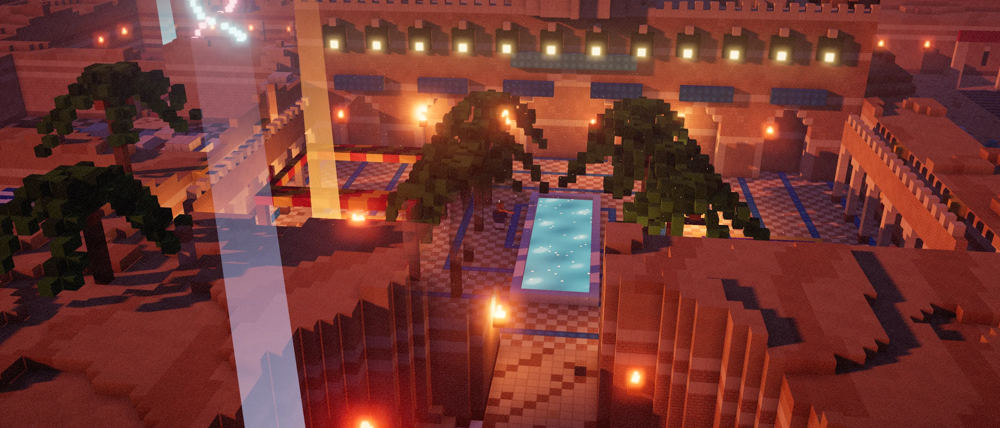

# Bharat Ravalot's portfolio

**A personal portfolio you can explore as a 3D voxel labyrinth hidden under the desert, or browse as a quick project index.**

[Preview](#preview) · [Run locally](#run-locally) · [How it works](#how-it-works) · [Design notes](DESIGN.md)

## Preview



- **The labyrinth (`/`).** Climb down from the dunes and find your way through twelve chambers, each holding a project or a piece of experience, to a palace courtyard at dusk. The browser builds the voxel world and synthesizes its sound.
- **The quick view (`/work/`).** Browse the same material on a single page. It works without JavaScript, prints cleanly, and serves as the fallback for browsers without WebGL 2.

| Project | What to explore |
| --- | --- |
| pileGo! | [Live app](https://pilego.app/) · [Source and screenshots](https://github.com/gothicscientist/pileGo-) |
| Thock | [Live builder](https://thock.cc/) · [Catalog and recommendation pipeline](https://github.com/gothicscientist/thock) |
| Strata | [Live research workspace](https://stratalab.cc/) · [Methods and architecture](https://github.com/gothicscientist/strata) |
| Rally Assist | [Extension preview and source](https://github.com/gothicscientist/rally-assist#preview) |

## Run locally

Use Node.js 22, the version used by the [Pages build](.github/workflows/deploy.yml).

```sh
npm ci
npm run dev       # http://localhost:5173
npm run build     # type-checks, then builds to dist/
npm run preview
```

Open [the labyrinth](http://localhost:5173/) or [the quick view](http://localhost:5173/work/) after starting Vite.

## How it works

- **One source for both views.** The project index is rendered at build time from the same TypeScript content the labyrinth uses.
- **Procedural voxels.** The whole labyrinth is a 256 x 64 x 256 voxel grid built in code at load, meshed into chunks with baked ambient occlusion and 16px pixel textures, then lit by three.js with sun shadows, torch lights, bloom and fog. The sun sinks as you get further along the route.
- **Procedural sound.** Web Audio synthesizes the wind, the drone, footsteps and fire.

## Where things live


| Path | What it is |
| --- | --- |
| `src/content.ts` | Every fact on the site. Edit words here only. |
| `src/game/build.ts` | The labyrinth: corridors, chambers and everything in them |
| `src/game/voxels.ts` | Voxel materials and the chunk mesher |
| `src/game/atlas.ts` | The 16px pixel textures, drawn in code |
| `src/game/main.ts` | Renderer, light, time of day, camera, wall cutaway, input and props |
| `src/game/hero.ts` | The wanderer's movement, collision and scarf |
| `src/game/ui.ts` | Intro, chamber cards, the chambers map and touch controls |
| `src/game/audio.ts` | Synthesised wind, drone, footsteps and fire |
| `src/work/render.ts` | The quick view's HTML, rendered at build time |
| `DESIGN.md` | Art direction and the decisions behind it |

## Deploy

The [deployment workflow](.github/workflows/deploy.yml) builds on pushes to `main` and targets GitHub Pages. The configured domain is recorded in [`public/CNAME`](public/CNAME). Follow the [workflow runs](https://github.com/gothicscientist/bharatravalot.com/actions/workflows/deploy.yml) for deployment status.

## Stills

`/?still&x=<x>&z=<z>` renders a clean frame with the wanderer at that spot and no interface. `p` sets the time of day along the route (0 to 1), and `yaw`, `pitch`, `dist` and `fog` adjust the camera. The hero image and `og.jpg` are captured this way.
