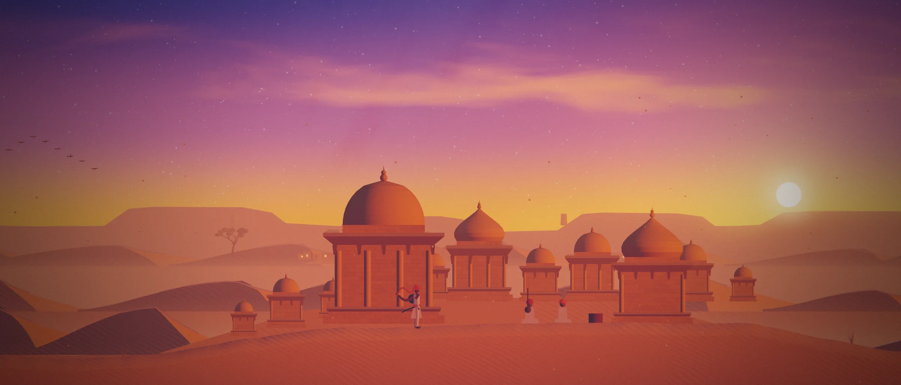

# Bharat Ravalot's portfolio

**A personal portfolio you can explore as a walk across the Thar Desert near Jaisalmer, or browse as a quick project index.**

[Preview](#preview) · [Run locally](#run-locally) · [How it works](#how-it-works) · [Design notes](DESIGN.md)

## Preview



- **The journey (`/`).** Walk west from before dawn to the last campfire. Twelve stops present projects and experience. The browser draws the 2.5D world and synthesizes its sound.
- **The quick view (`/work/`).** Browse the same material on a single page. It works without JavaScript, prints cleanly, and serves as the fallback for browsers without WebGL 2.

| Project | What to explore |
| --- | --- |
| pileGo! | [Live app](https://pilego.app/) · [Source and screenshots](https://github.com/gothicscientist/pileGo-) |
| Thock | [Live builder](https://thock.cc/) · [Catalog and recommendation pipeline](https://github.com/gothicscientist/thock) |
| Strata | [Live research workspace](https://stratalab.cc/) · [Methods and architecture](https://github.com/gothicscientist/strata) |
| Rally Assist | [Extension preview and source](https://github.com/gothicscientist/rally-assist#preview) |

## Run locally

Use Node.js 22, the version used by the [Pages build](.github/workflows/deploy.yml).

```sh
npm ci
npm run dev       # http://localhost:5173
npm run build     # type-checks, then builds to dist/
npm run preview
```

Open [the journey](http://localhost:5173/) or [the quick view](http://localhost:5173/work/) after starting Vite.

## How it works

- **One source for both views.** The project index is rendered at build time from the same TypeScript content the journey uses.
- **Procedural scene and sound.** WebGL 2 lights flat geometry using 3D normals. The traveller's position drives the changing sky and palette, and Web Audio synthesizes the ambience.

## Where things live


| Path | What it is |
| --- | --- |
| `src/content.ts` | Every fact on the site, and the list of places. Edit words here only. |
| `src/world/layout.ts` | Terrain, layers and what stands at each place |
| `src/world/art/` | Architecture, nature and people, built from lit vector shapes |
| `src/world/palette.ts` | The colour of the day, keyed to how far west you are |
| `src/world/shaders.ts`, `src/world/renderer.ts` | WebGL 2 lighting, sky, bloom, light shafts and grading |
| `src/world/traveller.ts` | The traveller's walk, run, jump, sit and cloth |
| `src/world/audio.ts` | Synthesised wind, tanpura, footsteps and fire |
| `src/work/render.ts` | The quick view's HTML, rendered at build time |
| `DESIGN.md` | Art direction and the decisions behind it |

## Deploy

The [deployment workflow](.github/workflows/deploy.yml) builds on pushes to `main` and targets GitHub Pages. The configured domain is recorded in [`public/CNAME`](public/CNAME). Follow the [workflow runs](https://github.com/gothicscientist/bharatravalot.com/actions/workflows/deploy.yml) for deployment status.

## Stills

`?still=<x>` renders a clean frame of the journey at world position `x` with no interface (optional `vh`, `dx`, `dy` adjust the camera). The hero image and `og.jpg` are captured this way.
